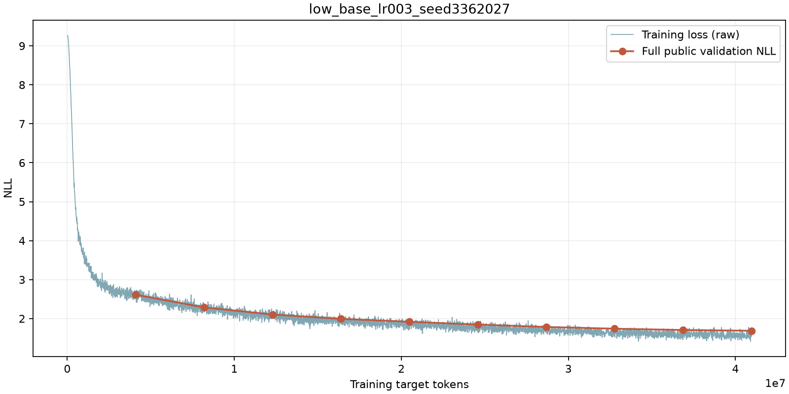

# Transformer语言模型作业

个人完成。具体日期和提交入口由教师通知。

## 1．要做什么

**补全代码，从随机初始化训练英文故事语言模型，完成规定实验。**

| 项目 | 要求 |
|---|---|
| 模型总参数量 | ≤50,000,000，包含嵌入与输出层 |
| 每次正式训练预算 | 40,960,000个预测目标token |
| 公开验证与隐藏测试 | NLL均≤1.70；对应PPL约≤5.4739 |
| 最佳评分权重 | 完整CPU FP32权重，≤240,000,000字节（240 MB） |

PPL=exp(NLL)，判定使用未四舍五入的NLL。只用发放的100,000篇训练故事更新参数；2,000篇公开验证故事用于调参、选模型。教师隐藏测试不发放。正式模型使用课程10,000词BPE，不得加入额外语料或预训练权重，不得集成、使用EMA或平均checkpoint。

1. 在`basics/`完成BPE、模型组件、因果Transformer、损失、优化器、调度、梯度裁剪、训练与生成。
2. 补全`tests/adapters.py`的**21个测试适配函数**，将自己的实现接入测试。保留签名，不改测试断言和参考结果；测试夹具权重只用于测试。
3. 补全`course_entry.py`的`train`、`load_model`、`export`三个接口，运行测试。格式见[接口速查](docs/接口与提交格式.md)。
4. 完成下列实验，每次训练保存实际配置、完整CSV和曲线。

| 实验 | 最低要求 |
|---|---|
| 学习率 | 至少3个设置，参考0.0003、0.001、0.003 |
| 有效batch | 至少3个设置，参考16、32、64；同组保持训练token预算一致 |
| 模块消融 | 去RMSNorm、改Post-norm、去RoPE、SwiGLU改SiLU，共4项，与基准比较 |
| BPE与生成 | 完成BPE训练/编码/解码；用固定prompts对照贪心与temperature/top-p采样 |

训练实验配置在`configs/experiments/`，生成提示在`configs/prompts.json`。同一次基准训练可用于多个对比，保留一份记录即可。BPE和生成仍须完成，不另交输出附件。允许使用现成组件和AI辅助，但不得编造实验记录。

## 2．怎么开始

**必须使用指定环境：Linux、Python 3.12.14、PyTorch 2.11.0＋CUDA 12.8及包内锁定依赖。GPU型号不限。** 在Linux终端安装uv后，进入本目录执行：

```bash
curl -LsSf https://astral.sh/uv/0.12.18/install.sh | sh
# 按安装器提示重新打开终端，进入 Transformer_low 后执行：
uv python install 3.12.14
uv sync --frozen --python 3.12.14
uv run --frozen python -m course_tools.environment --check
uv run --frozen python -m course_tools.verify_data
```

完成代码后，运行测试、训练、绘图和导出：

```bash
uv run --frozen pytest tests -q
uv run --frozen python course_entry.py train --config configs/baseline.json --run-dir runs/final
uv run --frozen python -m course_tools.plot_logs runs/final
uv run --frozen python course_entry.py export --checkpoint runs/final/best.pt --output final.weights.pt
```

初始框架出现`NotImplementedError`属于预期。起始模型为4层、512维、16头、FFN1344，共22,696,448参数，学习率0.001；可在允许范围内调整，**起始配置不保证直接达标**。默认有效batch32、上下文256，共5,000步；改变batch时保持训练token预算不变。

每4,096,000目标token完整验证一次，保存公开NLL最低的`best.pt`。最终评分模型须来自`mode=ranked`运行。0/20/60/100%完整checkpoint由本人保管至成绩复核结束，需要核验时再提供。恢复训练与CSV格式见接口文档。

## 3．分两阶段提交

**第一阶段：网页填空自查，只上传最佳评分权重。**

填写学号、提交码、最终实验目录名、选中模型步数、公开验证NLL、实际模型结构和环境版本，完成依赖与训练声明。网页自动计算PPL和参数量，展示固定词表、上下文与预算；无需上传配置或本地自检报告。

服务器按填写结构独立加载权重、检查格式和参数量，并重算完整公开验证NLL。通过后才开放第二阶段。网页环境填写只是声明，不代表已验证你的电脑环境；本地检查也不能替代服务器验收。

**第二阶段：上传一个普通ZIP，≤250,000,000字节（250 MB），只包含：**

- 全部实现代码及环境文件（`pyproject.toml`、`uv.lock`、`.python-version`等）。
- 每次必做训练实验的`config.json`、`metrics.csv`、`curve.png`，每次实验一个独立目录。

目录名就是运行编号，最佳模型所属目录名须与第一阶段一致，配置记录实际训练值。不另交报告、填写后的README、测试输出、生成样例、自检报告或JSONL。ZIP不放数据、模型权重、checkpoint、虚拟环境和缓存。[材料目录示例](docs/提交模板.md)只供参考，不是必交文件。

ZIP上传成功表示材料已归档，不表示代码已执行通过。公开验证通过不等于隐藏测试达标。

## 4．真实记录范例

[low_base_lr003_seed3362027](examples/low_base_lr003_seed3362027/)提供实际`config.json`、完整`metrics.csv`和`curve.png`。该次运行22,696,448参数，学习率0.003，训练5,000步、40,960,000目标token。

网页填写示例：实验目录`low_base_lr003_seed3362027`，选中步数`5000`，公开验证NLL `1.6875943767483432`；PPL自动换算为`5.406459145098503`。CSV包含5,000条训练记录和10条验证记录。



范例只说明记录格式，须提交自己的结果，不附教师代码或权重。
